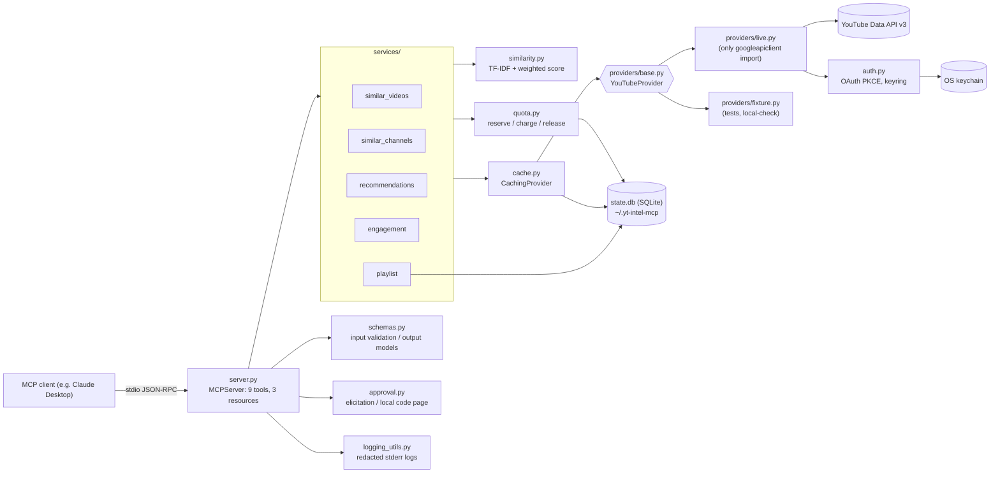
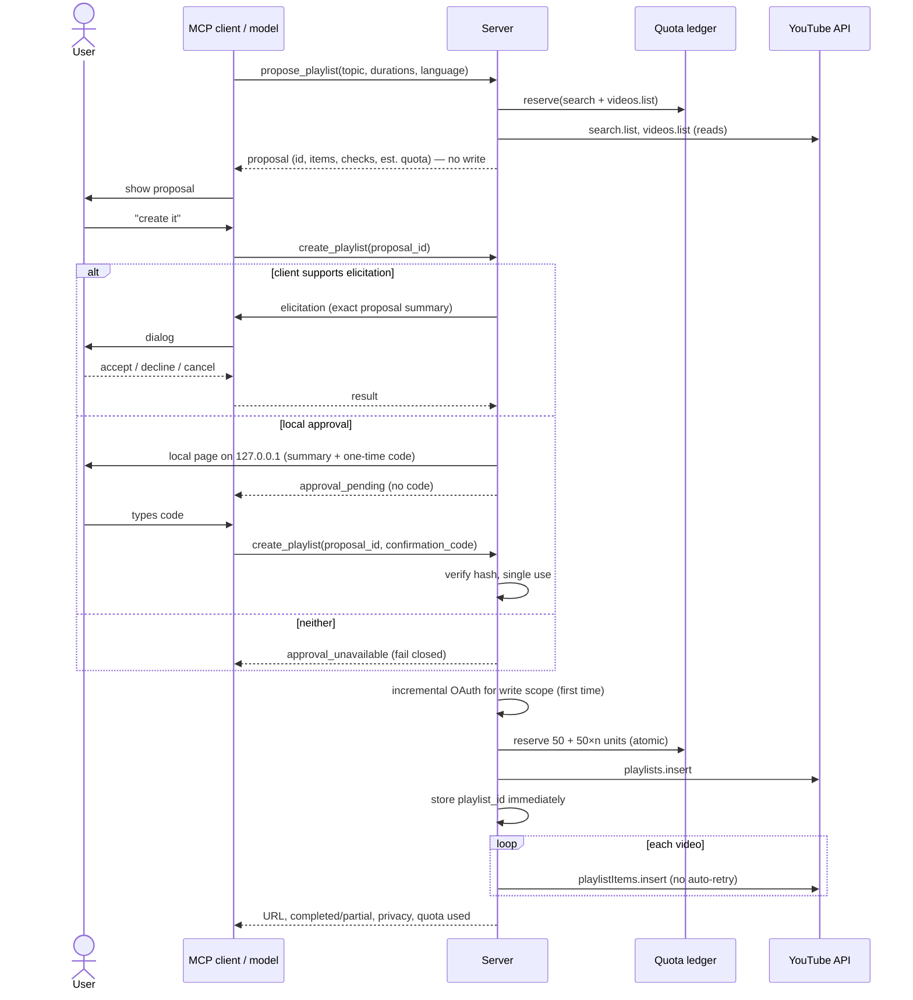
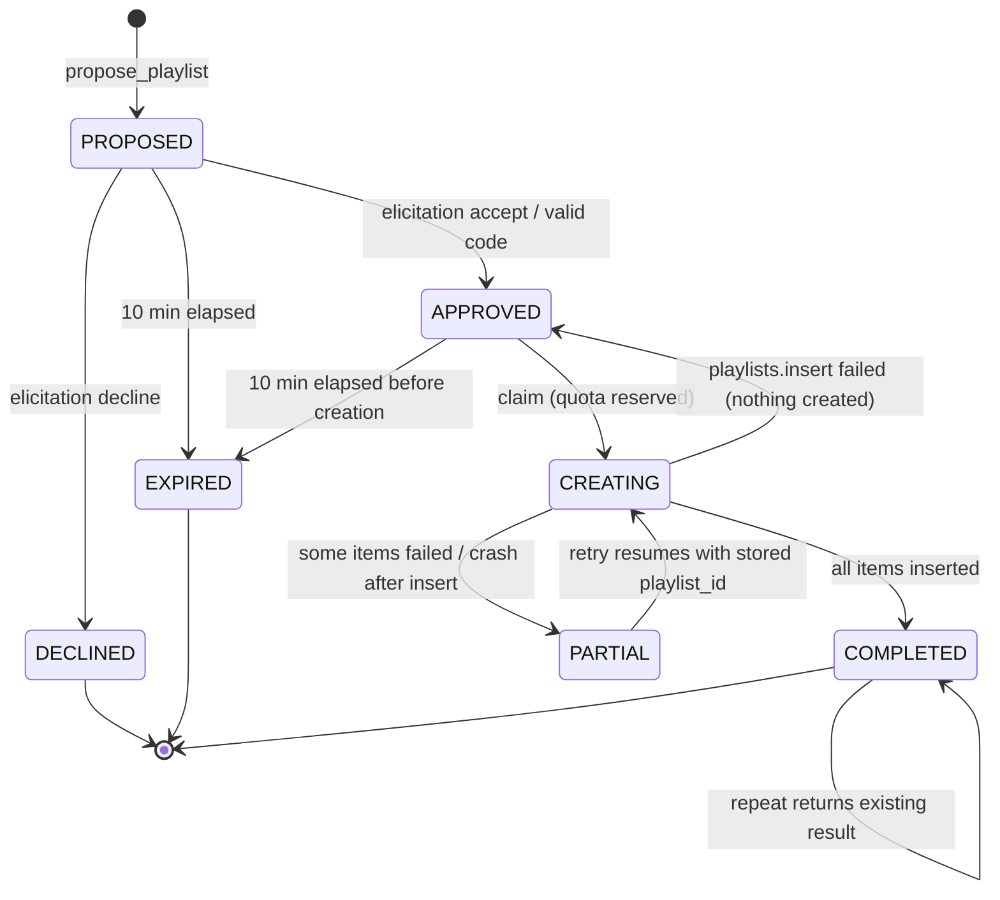
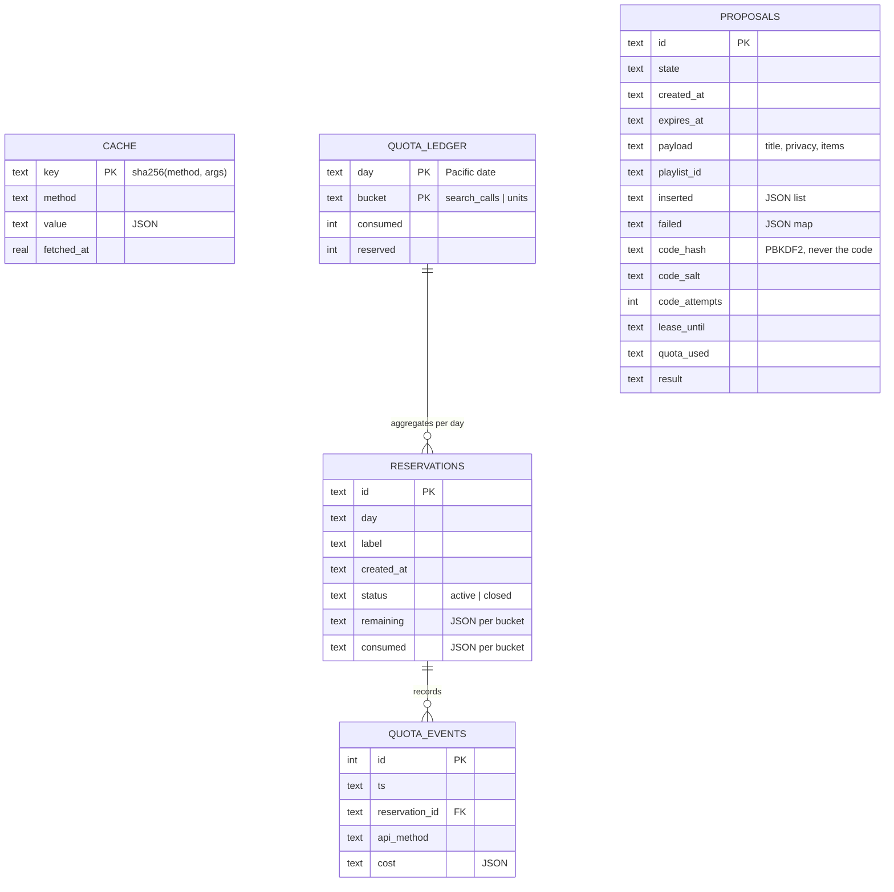

# Architecture (SE-2)

## Component diagram

Small support modules not shown: `ids.py` (URL/ID parsing), `duration.py`, `errors.py`, `clock.py` (injectable
clock), `config.py` (YAML loading), `storage.py` (SQLite connections, state directory outside the repo).

## Sequence: playlist confirmation

## Proposal state machine

## Data model (state.db)

## Key properties
- **Quota before calls:** services build a plan, `quota.reserve()` runs in `BEGIN IMMEDIATE`, and providers call
  `quota.charge()` before every HTTP request; a charge without an active reservation is refused.
- **Isolation:** only `providers/live.py` imports `googleapiclient`; services see the `YouTubeProvider` interface, which
  has no update/delete methods.
- **Concurrency:** tool handlers run services in worker threads; each SQLite operation opens its own connection.
