# Architecture and design (SE-2)

System design of the **YouTube Video Intelligence MCP Server**, release 1.0. This file is the source of the design PDF
[`docs/design.pdf`](design.pdf) (rebuild with `python scripts/build_design_pdf.py` after every change here or in
`docs/adr/`). Decisions are recorded as ADRs in [`docs/adr/`](adr/); the API reference is [`docs/api.md`](api.md).

## 1. Goals and constraints
- Let an AI client discover, analyse and curate YouTube videos for **one authorised user** (BR-1): similar videos
  (FR-1), similar channels (FR-2), recommendations (FR-3), engagement analysis (FR-4) and playlist creation (FR-5).
- **Official YouTube Data API v3 only.** No scraping, no transcripts, no watch history, no related-videos endpoint
  (it does not exist): similarity is computed locally from metadata (ADR 0004).
- **Quota is a hard limit** (10,000 units/day, 100 searches/day by default): every workflow reserves its worst-case
  cost before the first call (ADR 0003).
- **The only write is creating a new playlist**, and only after explicit approval from the human (ADR 0002). Existing
  videos and playlists are never modified or deleted.
- **All YouTube text is untrusted data**, never instructions (prompt-injection safe).
- Local desktop tool: stdio transport, Python 3.11+, official MCP SDK (ADR 0001); state outside the repository (ADR 0005).

## 2. System context
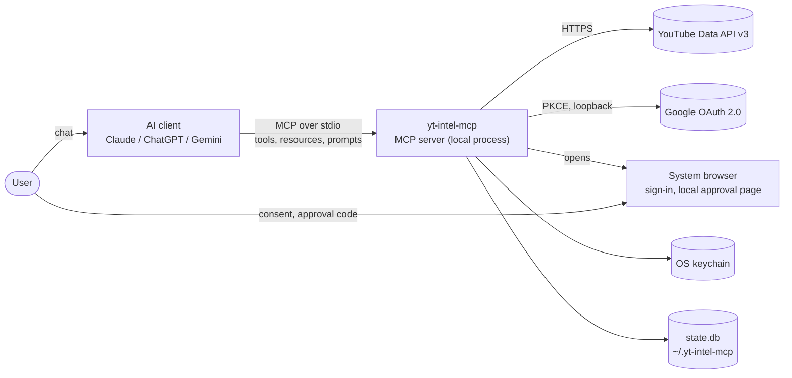

## 3. Deployment
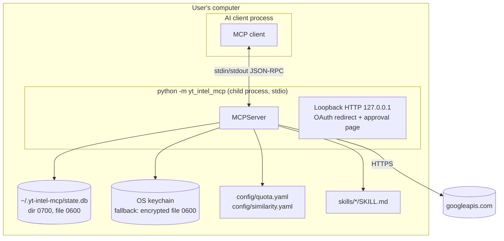
The client starts the server as a child process (configuration snippet in `docs/user-guide.md`). Logs go to stderr,
because stdout is the transport. There is no network listener except short-lived loopback servers for the OAuth
redirect and the approval page.

## 4. Component view
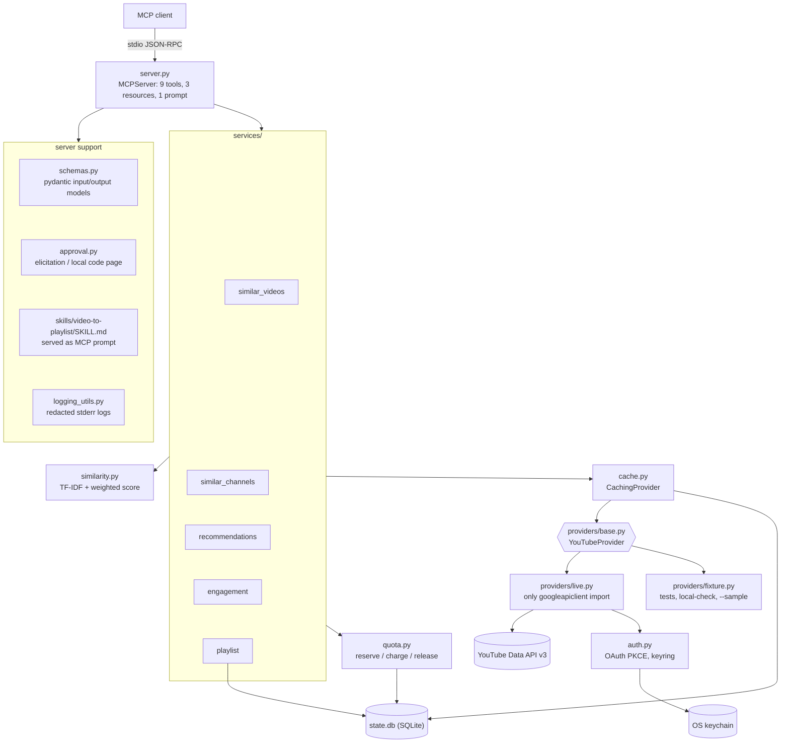

| Module | Responsibility | Requirements |
|---|---|---|
| `server.py` | Builds the app (`build_app`), registers tools, resources and the skill prompt, maps results and errors to MCP | FR-8, UI-1, UI-3, NFR-19 |
| `schemas.py` | Pydantic models for every tool input and output; normalises API resources (`video_from_api`, `channel_from_api`) | FR-8.3, FR-1.2 |
| `services/similar_videos.py` | FR-1 workflow: seed lookup, candidate search, scoring | FR-1 |
| `services/similar_channels.py` | FR-2 workflow: channel resolution (ID, @handle, /channel/, /user/, /c/), content-first ranking | FR-2 |
| `services/recommendations.py` | FR-3: interest profile from likes, subscriptions and playlists; candidate search; signals | FR-3 |
| `services/engagement.py` | FR-4: top channels and categories, trends, duration buckets, period comparison, computed locally | FR-4 |
| `services/playlist.py` | FR-5: planner (topic search or `candidate_video_ids`), proposal store, approval state machine, idempotent creation | FR-5 |
| `similarity.py` | Tokenising, TF-IDF cosine, weighted video score, channel ranking, explanations | FR-1.4, FR-2 |
| `quota.py` | Cost table, plans, atomic reservation, per-call charging, ledger, Pacific-time reset | FR-6, TQ-6 |
| `cache.py` | `CachingProvider`: 24 h serve, 7 d purge, never caches writes | FR-6.6, NFR-11 |
| `providers/base.py` | `YouTubeProvider` interface: 10 reads + 2 writes; no update, delete or history methods | SE-6, NFR-5 |
| `providers/live.py` | Google API client, error mapping, bounded retries for reads only | NFR-13, NFR-15 |
| `providers/fixture.py` | Synthetic JSON fixtures, call log, error injection | TQ-5 |
| `auth.py` | Installed-app OAuth (loopback, state, PKCE), incremental write scope, token storage, revocation | FR-7 |
| `approval.py` | Elicitation and the local one-time-code page | FR-5.6 |
| `ids.py`, `duration.py` | URL/ID parsing, ISO 8601 durations | FR-1.1, FR-2.1, FR-4.5 |
| `errors.py` | `YTIntelError` hierarchy with code, cause, next step | UI-3 |
| `storage.py`, `clock.py`, `config.py`, `logging_utils.py` | SQLite state outside the repo, injectable clock, YAML config, redacted logging with per-tool timing | NFR-10, NFR-1 |

## 5. Provider abstraction
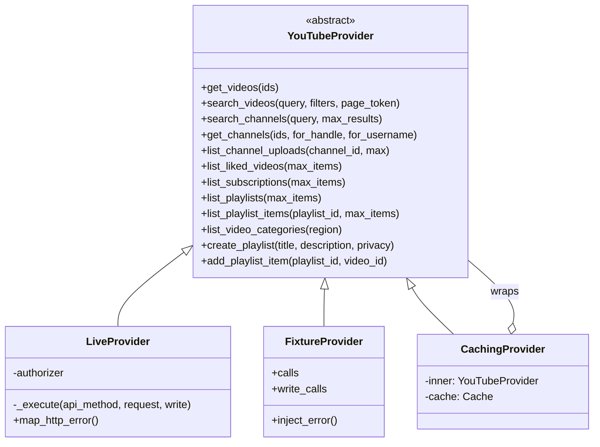
Services only see `CachingProvider`, so tests swap the live provider for fixtures without touching service code.
The interface has no method that could modify or delete existing content or read viewing history.

## 6. MCP surface
| Kind | Name | Writes to YouTube | Purpose |
|---|---|---|---|
| Tool | `find_similar_videos` | no | FR-1 ranked similar videos with scores and explanations; returns seed metadata for the skill's summary |
| Tool | `find_similar_channels` | no | FR-2 ranked similar channels; ambiguous `/c/` URLs return candidates |
| Tool | `recommend_videos` | no | FR-3 recommendations with contributing signals |
| Tool | `analyze_engagement` | no | FR-4 analysis for a period, optional comparison period |
| Tool | `propose_playlist` | no | FR-5 plan from a topic or from `candidate_video_ids`; returns a proposal valid 10 minutes |
| Tool | `create_playlist` | **yes** | FR-5 creation of one new playlist after user approval |
| Tool | `start_authorization`, `revoke_authorization`, `clear_cache` | no | FR-7 sign-in, revocation, local data deletion |
| Resource | `quota://status`, `config://server`, `proposal://{id}` | no | Quota per bucket, non-secret config, proposal view (no codes) |
| Prompt | `video-to-playlist` | no (the prompt itself) | Agent Skill SK-1 exposed through the server; text is `skills/video-to-playlist/SKILL.md` |

Every tool result has structured content plus a short summary text (UI-1). Errors are `isError` results with
`code`, `cause` and `next_step` (UI-3). Descriptions state whether a tool writes (NFR-19). Agent Skills are not
registered as tools or resources (FR-8.5); they are served as prompts.

## 7. Key workflows

### 7.1 Read workflow with quota (FR-1; FR-2 to FR-4 follow the same pattern)
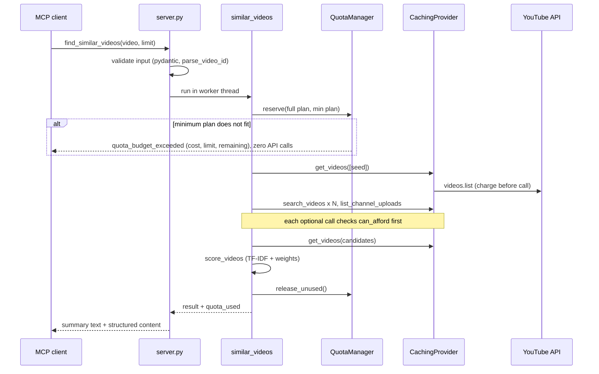

### 7.2 Playlist proposal and approval (FR-5)
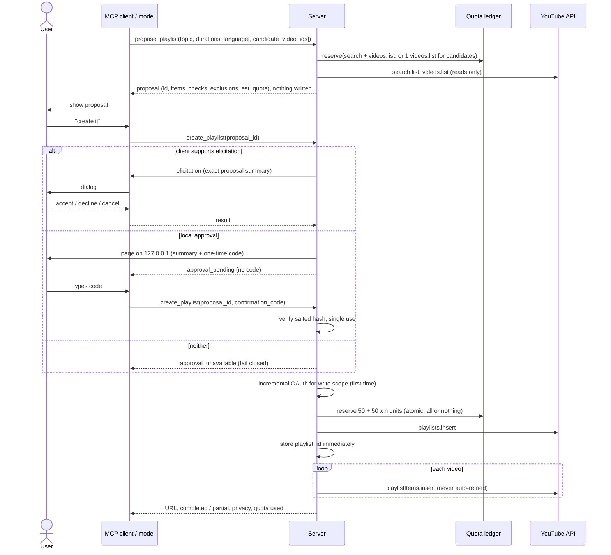

### 7.3 Agent Skill `video-to-playlist` (SK-1)
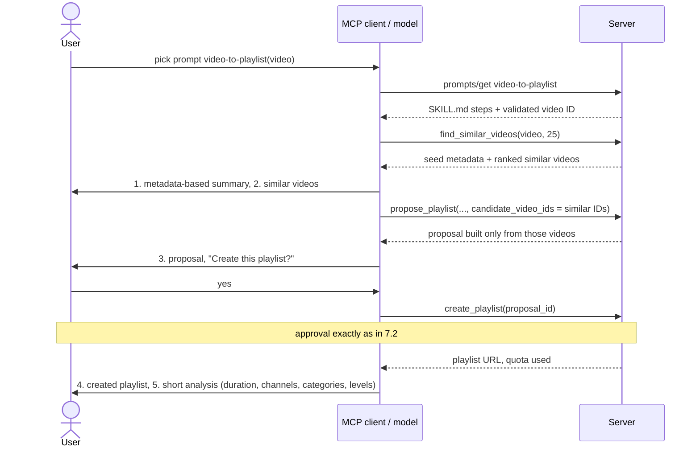

### 7.4 Authorisation (FR-7)
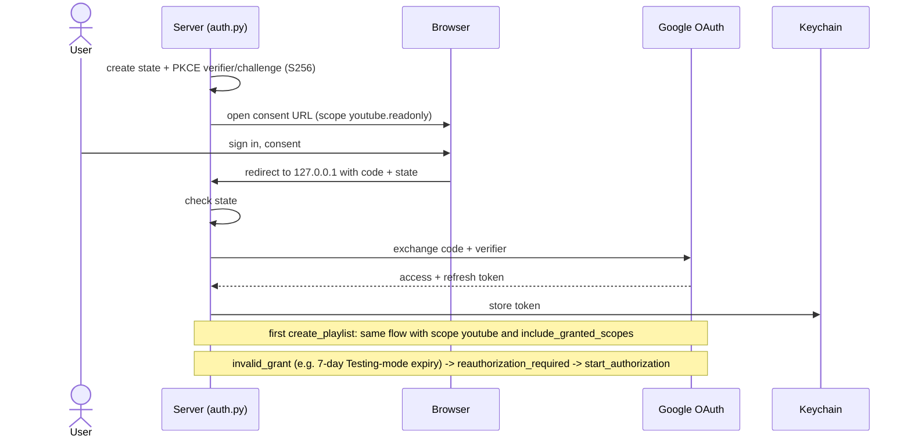

## 8. Proposal state machine
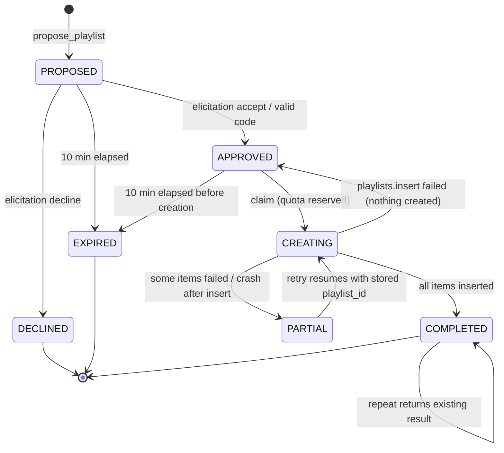

## 9. Data model (state.db)
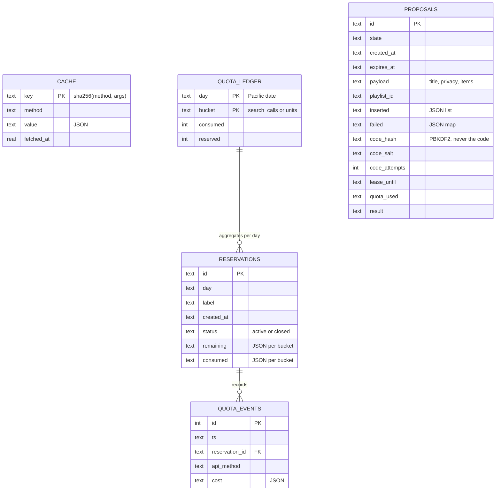

## 10. Similarity design (ADR 0004)
- **Video document:** title twice, tags, description (max 2,000 characters); URLs, English and domain stop words removed.
- **Video score** = 0.55 text cosine + 0.15 shared tags (Jaccard) + 0.10 same category + 0.05 same channel + 0.10
  duration closeness + 0.05 language match (`config/similarity.yaml`). Ties are broken by video ID; each result explains
  its shared terms, tags and matching signals.
- **Channels:** profile = channel title and description plus recent upload titles and descriptions. Ranked by content
  similarity at fixed precision; subscriber closeness, upload cadence and language only break ties.
- **Recommendations:** an interest profile (weighted terms from likes, playlist items and subscriptions) is compared
  with candidates by TF-IDF cosine (0.6) plus liked-channel (0.2), subscribed (0.1) and category (0.1) signals.
- **Playlist selection:** greedy fill by relevance, then a bounded subset-sum if the fill is below 90 %; durations are
  rounded up, so the total never exceeds the target. Items are ordered intro, intermediate, advanced by title keywords.

## 11. Quota design (ADR 0003)
| Method | `search_calls` | `units` |
|---|---|---|
| `search.list` | 1 | 100 |
| `videos.list`, `channels.list`, `playlists.list`, `playlistItems.list`, `subscriptions.list`, `videoCategories.list` | 0 | 1 |
| `playlists.insert`, `playlistItems.insert` | 0 | 50 |

Services reserve a worst-case **plan** before the first call (`BEGIN IMMEDIATE` across buckets). A minimum plan must
fit, otherwise the request fails with `quota_budget_exceeded` and zero API calls (TQ-6). Providers charge before every
HTTP attempt; unused reservation is released. `quotaExceeded` from YouTube is never retried and marks the day as
exhausted. Cache hits cost nothing.

## 12. Error model
| Code | Raised when | Next step for the user |
|---|---|---|
| `invalid_input` | Schema or ID validation fails | Correct the input |
| `not_found` | Private, deleted or unknown video/channel | Check the ID |
| `quota_budget_exceeded` | Reservation does not fit the remaining budget | Wait for the Pacific-time reset or lower the limit |
| `quota_exceeded` | YouTube reports quota exhaustion | Wait for reset |
| `rate_limited`, `transient_error` | 429 / 5xx after bounded read retries | Retry later |
| `reauthorization_required` | `invalid_grant`, revoked or expired token | `start_authorization` |
| `authorization_required`, `write_scope_required` | No token / read-only token for a write | Sign in / approve write scope |
| `youtube_signup_required` | Account has no YouTube channel | Create a channel |
| `proposal_not_found`, `proposal_expired`, `proposal_declined`, `proposal_in_progress` | Proposal state does not allow the action | Propose again / wait |
| `confirmation_invalid`, `approval_unavailable` | Wrong or reused code / no safe approval channel | Use the approval page / a client with elicitation |
| `internal_error` | Anything unexpected | Retry; check the redacted log |

Library messages and stack traces are never returned to the client.

## 13. Security design
| Threat | Control |
|---|---|
| Model writes without the user's consent (incl. prompt injection in titles/descriptions) | Only `create_playlist` writes; approval comes from elicitation or a code shown outside the chat; codes are single use, salted PBKDF2 hashes, 3 attempts; fail closed |
| Over-broad OAuth access | `youtube.readonly` for reads; `youtube` requested only at first playlist creation; PKCE + `state`, loopback redirect |
| Token or secret leakage | Tokens in the OS keychain; state directory outside the repo (refused inside it); redacted logs; gitleaks in CI; no secrets in fixtures |
| Personal data exposure | Fixtures are synthetic; cached account data expires and is deleted by `clear_cache` / `revoke_authorization` |
| Unsafe input | Pydantic validation of every parameter; strict ID parsers; HTML-escaped approval page |
| Destructive API use | Provider interface has no update/delete methods; only `providers/live.py` imports the Google client |
| Quota exhaustion | Atomic per-bucket reservation before the first call; no retry on `quotaExceeded`; writes never auto-retried |

## 14. Test architecture
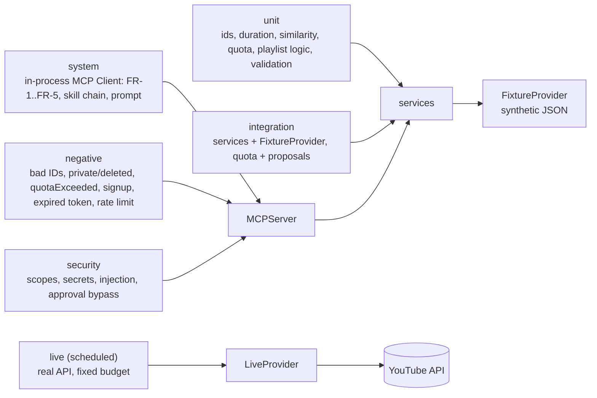
CI (`.github/workflows/ci.yml`) runs lint, the offline suites on Ubuntu and Windows (Python 3.11/3.12) with an 85 %
coverage gate, gitleaks and the skill and brain validators, and keeps JUnit and coverage reports as artifacts.
`live-api.yml` runs the live suite weekly with a fixed quota budget (TQ-5). Plan and results:
`docs/tests/test-plan.md`, `docs/tests/test-results.md`; defects: `docs/tests/defect-log.md`.

## 15. Knowledge base and Agent Skills
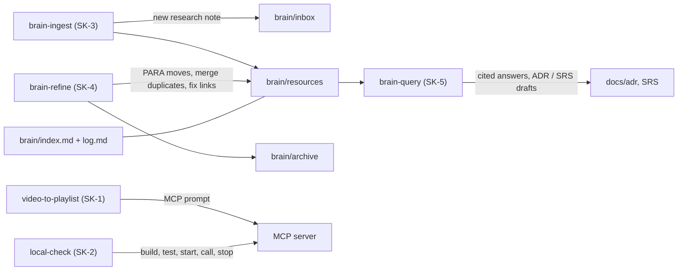
The `brain/` folder is an Obsidian vault (PARA: projects, areas, resources, archive, inbox; `index.md` map of content,
`log.md` history). `scripts/validate_brain.py` and `scripts/validate_skills.py` enforce note and skill format in CI.

## 16. Concurrency and resilience
- Tool handlers run services in worker threads; each SQLite operation opens its own short connection.
- Proposal transitions use compare-and-set updates; `CREATING` holds a 2-minute lease so a crashed run can resume.
- Reads are retried at most 3 times with bounded exponential backoff on 429/5xx; writes and `quotaExceeded` never.

## 17. Architecture decisions
| ADR | Decision |
|---|---|
| [0001](adr/0001-runtime-and-sdk.md) | Python 3.11+, official MCP SDK (`MCPServer`), stdio only |
| [0002](adr/0002-confirmation-mechanism.md) | Elicitation, else local one-time code, else fail closed |
| [0003](adr/0003-quota-reservation.md) | Per-bucket ledger with atomic reservation before the first call |
| [0004](adr/0004-similarity-approach.md) | TF-IDF cosine plus weighted, explainable metadata signals |
| [0005](adr/0005-storage-and-token-storage.md) | One SQLite file outside the repo; tokens in the OS keychain |
