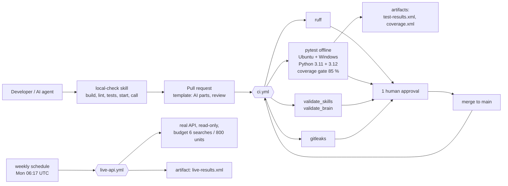

# Continuous testing and CI plan (Stage 3)

Plan for testing the YouTube Video Intelligence MCP Server continuously. Results are recorded in
[test-results.md](test-results.md), defects in [defect-log.md](defect-log.md) and skill evaluations in
[skill-evaluations.md](skill-evaluations.md).

## 1. Objectives
- Every functional requirement (FR-1 to FR-5) is verified end to end through the MCP interface.
- The safety properties hold on every change: no write without user approval, quota rejected before the first call,
  no secrets or personal data, metadata never treated as instructions.
- Tests run offline and deterministically in CI; the real YouTube API is exercised only by a separate, scheduled job
  with a fixed quota budget (TQ-5).

## 2. Test levels
| Level | Folder | What it covers | Requirement |
|---|---|---|---|
| Unit | `tests/unit/` | ID parsing, ISO 8601 durations, similarity scoring and ordering, quota table and reservation, cache expiry, playlist constraint logic, engagement aggregates, input validation, logging redaction, validators, skill prompt text, defect-log consistency | TQ-1 |
| Integration | `tests/integration/` | Services with the fixture provider, quota + proposal store, retrieval stopping at the quota limit, channel resolution, provider error mapping | TQ-2 |
| System (end to end) | `tests/system/` | FR-1 to FR-5 through an in-process MCP client session; video-to-playlist chain and its six evaluation scenarios; resources and prompt | TQ-3, TQ-7 |
| Negative | `tests/negative/` | Invalid/malformed IDs, private/deleted videos, missing tags, `quotaExceeded`, `youtubeSignupRequired`, expired/revoked tokens, rate limiting, unexpected errors | TQ-4 |
| Security | `tests/security/` | Minimal OAuth scopes, token storage outside the repo, no secrets in files, input validation, prompt injection cannot bypass approval, confirmation code never leaks | Security testing |
| Quota | `tests/integration/test_quota_and_proposals.py`, `tests/unit/test_quota.py` | Workflow over budget rejected with zero API calls; concurrent reservations | TQ-6, TQ-9 |
| Live | `tests/live/` (marker `live`) | Real API: FR-1, FR-2, FR-4 read-only with a read-only token | TQ-5 |
| Performance | `scripts/benchmark.py` | Local processing time vs. API wait per workflow | NFR-2 |
| Skill evaluations | `tests/system/test_skill_video_to_playlist.py`, `docs/tests/skill-evidence-*.md` | Agent Skills against fixed scenarios | TQ-7 |

## 3. Test data
- **Fixtures only** in CI: synthetic JSON in `tests/fixtures/` (videos, channels, account, categories). No real user
  data, tokens or IDs of real accounts (checked by `tests/security/test_security.py`).
- The fixture provider records every call and can inject API errors, so tests assert on exact call counts (for
  example "zero calls when over budget").
- Time is controlled with `FakeClock` (proposal expiry, quota reset, cache age).
- Live tests use a dedicated test account whose token, video and channel come from GitHub secrets.

## 4. Continuous testing pipeline

| Trigger | Workflow | Jobs | Blocking |
|---|---|---|---|
| Every pull request | `ci.yml` | lint, offline tests + coverage (4-job matrix), skill + brain validators, gitleaks | yes, with 1 approving review (AGENTS.md) |
| Push to `main` | `ci.yml` | same as above | regressions are fixed before new work |
| Weekly (Mon 06:17 UTC) and manual | `live-api.yml` | live read-only tests, environment `live-api` | no; failures open a defect |
| Before every PR (local) | `local-check` skill (`scripts/local_check.py`) | build, lint + tests, start server, call a tool, stop | by convention |

## 5. Entry and exit criteria
- **Entry:** the change builds; new behaviour has tests in the matching folder (AGENTS.md).
- **Exit (merge):** ruff clean; all offline tests pass on the whole matrix; line coverage of `yt_intel_mcp` at least
  85 % (`--cov-fail-under=85`); both validators pass; gitleaks finds nothing; one human approval.
- **Release:** the exit criteria hold, the latest live run passed, skill evaluations are recorded, and every defect is
  closed with a regression test.

## 6. Live API budget (TQ-5)
`tests/live/test_live_api.py` replaces the quota configuration with `LIVE_BUDGET = {"search_calls": 6, "units": 800}`
and asserts after each test that consumption stayed within it. No live test writes to YouTube. The workflow never runs
on pull requests, so forks and contributors cannot spend the quota.

## 7. Defect process (TQ-8)
1. Reproduce with a failing test in the matching folder.
2. Fix; the test becomes the regression test.
3. Add a row to [defect-log.md](defect-log.md) (ID, date, found by, severity, description, root cause, fix,
   regression test). `tests/unit/test_defect_log.py` fails the build if a row is incomplete or its regression test
   does not exist.

## 8. Roles
- Author (human or AI agent): writes tests with the change and runs `local-check`.
- Reviewer: reads every AI-generated diff, checks the PR template's checklist and the CI results.
- Maintainer: owns the `live-api` environment secrets and reviews live failures weekly.
